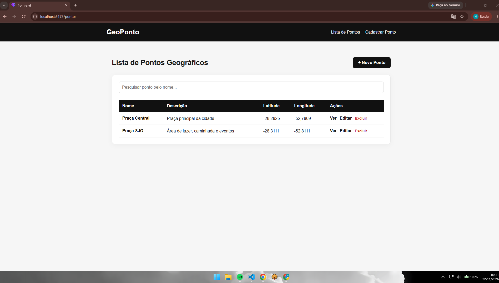
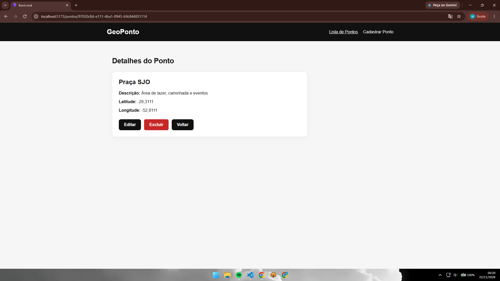

# GeoPoint 

# Disciplina: Frontend - Universidade Atitus 
# Professor: Matheus Henrique Barquette

# Integrantes:
Michel Balzan da Veiga — RA: 1139750
Marco Antonio Pasinato — RA: 1139597

# Projeto
O GeoPoint é um sistema desenvolvido para cadastrar, visualizar, pesquisar, editar e excluir pontos geográficos. O objetivo do trabalho é colocar em prática o desenvolvimento de interfaces e a integração com uma API.

# Como executar

É necessário ter o Node.js instalado.

**1. Iniciar o backend:**

`cd backend`

`npm install`

`node server.js`

**2. Em outro terminal, iniciar o frontend:**

`cd frontend`

`npm install`

`npm run dev`

**Acessar o sistema:** http://localhost:5173/pontos

**API utilizada:** http://localhost:3001/api/points

# Telas do sistema

**Listagem de pontos**

**Pesquisa de pontos**

**Cadastro de ponto**

**Detalhes do ponto**

**Edição de ponto**

