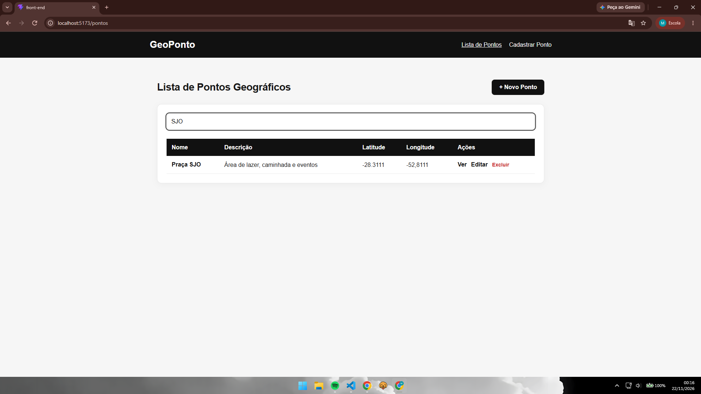
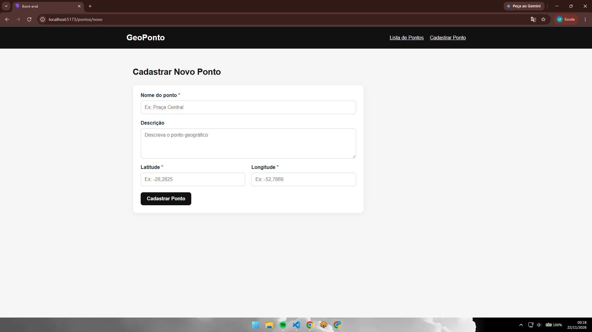

# GeoPonto - Trabalho G2 

# Alunos:
Michel Balzan da Veiga — RA: 1139750
Marco Antonio Pasinato — RA: 1139597

# Projeto

O GeoPonto é um sistema que permite cadastrar, listar, pesquisar, editar e excluir pontos geográficos. O projeto foi desenvolvido para colocar em prática os conhecimentos de React e integração com API.

Acesse: `http://localhost:5173/pontos`

*API utilizada:* `http://localhost:3001/api/points`

# Telas do sistema

*Listagem de pontos*

*Pesquisa de pontos*

*Cadastro de ponto*

*Detalhes do ponto*

*Edição de ponto*

